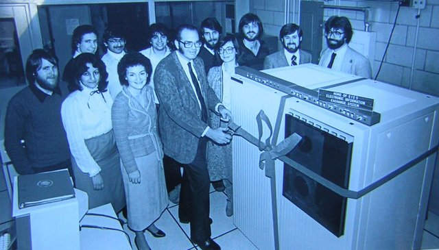
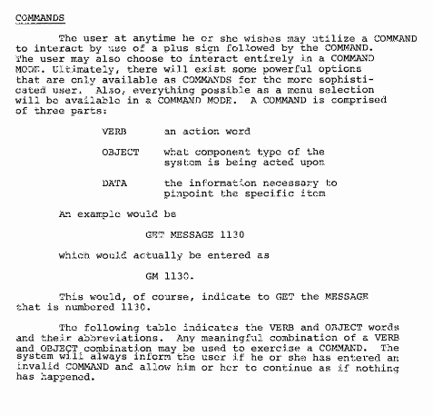
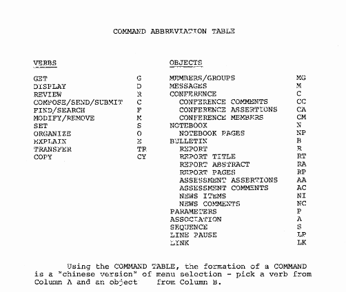
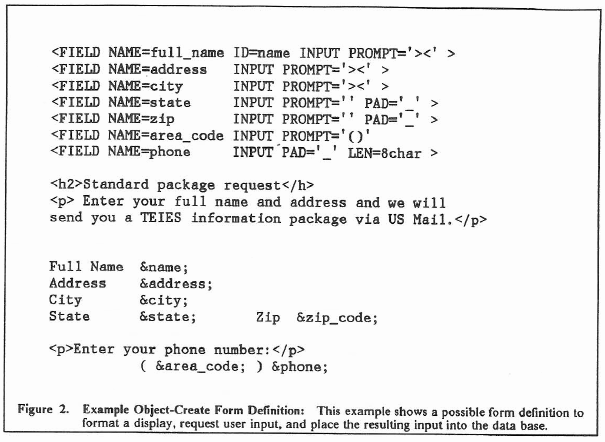
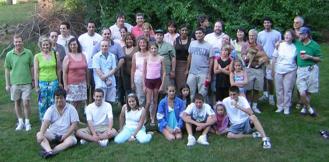

# The EIES legacy

QuantumOS is the third EIES. The first two were built at NJIT's Computerized
Conferencing and Communications Center, and much of what this repository is
trying to do was tried there first — some of it successfully enough that the
right move now is to copy it rather than reinvent it.

**The science of EIES was collective intelligence research.** The systems were
instruments: built to find out what happens when groups think together through a
medium designed for it, and what a medium has to provide before that works.
QuantumOS is a 21st-century tool for continuing that research — the same
question, on a substrate that did not exist in 1976.

This document records that lineage: what EIES did, which parts this project is
descended from, and which lessons are load-bearing in the current design. It is
written down because the reasoning behind several decisions here is only legible
if you know they were decided once already.

The epigraph, figures, and the Web 0.1/Web 3.0 comparison below come from a
presentation on that legacy, linked under [Primary sources](#primary-sources).

> "Whenever some 'new' feature or system comes out, I usually say to myself and
> others, 'oh, we had that functionality back on EIES…' People do look at me as
> if I must be crazy, they do not believe that anything like that existed 'way
> back when'…"
>
> — Starr Roxanne Hiltz

## The systems

**EIES (1976–)** — computer-mediated conferencing, built under Murray Turoff at
NJIT with NSF funding, from work begun in 1974. Electronic mail, conferences,
membership directories, data collection forms, global searches, personal
indexing. It ran for years and carried real communities: scientific research
groups, the homebound handicapped, and eventually classrooms.

The deck behind the figures here, *Back to the Network Nation Future: Web 0.1 =
Web 3.0?*, inventories what EIES had: inquiry networking, decision support,
groupware, anonymity and screen names, help everywhere, object orientation and
object-action commands, dynamic text and dynamic interfaces, interface
tailorability, collaborative dictionaries, SGML forms, hypertext, instant
messaging, and permission delegation. It reads like a checklist of things later
rediscovered.

**EIES2 (1980s–90s)** — directed by Jim Whitescarver, implementing distributed
Smalltalk as a decentralized research, development and operational environment
for distributed CSCW. It supported the Virtual Classroom for years, until
funding to maintain it ran out. That thread continues here — see the
[Collaborative Learning case study](CollaborativeLearningCaseStudy.md) and
[Room Best Practices](Room_Best_Practices.md).

The deck's system row is longer than the EIES, EIES2, and QuantumOS story told
here: Emisari, EIES1/2, and TEIES. Emisari was Turoff's emergency-management
system before EIES. TEIES was an IBM CMS prototype implemented alongside EIES2;
both supported SGML interface definitions and objects — the same SGML-and-object
lineage that later contributed to HTML and XML.

**QuantumOS** — this repository
([README](https://github.com/rhovision-org/quantum-os#readme)). Peer-to-peer
[rooms](MyRoom.md), a ZFA kernel, [governance by liquid
democracy](Governance.md), and a bridge to a trustless blockchain
([rholo](https://github.com/rhovision-org/rholo),
[RChain_Macros.md](RChain_Macros.md)) for the things that must outlive the room.
The vision it serves is stated in the [Manifesto](Manifesto.md); the
[README](README.md) is the practical entry point and the
[User Guide](User_Guide.md) is where to start using it.

**Quantum Logical Framework** — the theory behind QuantumOS, not a second system
([README](https://github.com/rhovision-org/quantum-logical-framework#readme),
[site](https://rhovision-org.github.io/quantum-logical-framework/)). Zero Free
Action is QLF's idea; the ZFA kernel above is its implementation, and a room's
capabilities are ZFA-valid twist strings rather than arbitrary tokens because of
it.

## Web 0.1 = Web 3.0

*A ribbon-cutting on the BBN TIP labelled EIES. Image from the Back to the
Network Nation Future deck.*

The deck's title is a question, and the answer is mostly yes. EIES was not a
primitive web; it was a different point on the same curve, with different
defaults. The deck runs the comparison across eighteen dimensions. The ones
that matter here are those this project keeps having to argue for:

| dimension | Web 0.1 (EIES) | Web 1.0 | Web 2.0 | Web 3.0 |
|---|---|---|---|---|
| Interface | rich, uniform, personalized, radically tailorable | static | dynamic, rich, personalized | dynamic, rich, uniform, personalized, radically tailorable |
| Authoring | collaborative | mass media, self publishing | collective | collaborative |
| Privacy | extreme, by default | threatened | basic | extreme, by default |
| Security | user determined (random question, one-time passwords) | weak, basic | public-private keys | user determined |
| Permission delegation | by default, user controlled | none | none | by default, user controlled |
| Participation | by default, facilitated | isolated | by default | by default, facilitated |
| Group semantics | group structural modeling, ranking, etc. | none | semantic web | collective semantics |
| Hackability | extreme | none intended | elitist | extreme |
| Formal language | Interact, ASN.1, SGML | HTML | XML, JavaScript | Rholang, Interact2? |

Read the end columns together. On interface, authoring, privacy, security,
permission delegation, participation, hackability, and formal language, the
deck's Web 3.0 is EIES again. The middle columns are the detour. Web 1.0 made
the page the unit and the publisher the author. Web 2.0 made the platform the
unit and the crowd the author, but left the platform owner holding the
authority. The deck's gloss on Web 2.0 is that it "is made of people"; EIES's
insight was that the people could rewrite the system. That is the difference
between participation and authorship.

The formal-language row is the one to look at twice. The deck's Web 3.0 entry is
"Rholang, Interact2?" — the question mark is doing real work, and the guess is a
fair description of what this repository is trying to build. The rest of this
document is about which parts of that guess are load-bearing.

## INTERACT: user programming, and why it matters here

The part of EIES most directly ancestral to this project is INTERACT, its
command language. Jim Whitescarver was largely responsible for it, along with
John Howell, Dave Harvy and Al Leurck. He and Turoff published on an early
version as an interface language around 1979.

INTERACT was BASIC-like — real control flow, powerful array functions,
dictionaries — and was both an interface language and a general-purpose one.
Commands were inputs to the system that could read prompts and answer them
conditionally, matching on the text of the last input to decide what to do next.
Many commands never touched the system at all and were simply programs.

**The command was the unit of the interface language.** A command was a verb,
an object, and data, and it was an input like any other: a user could type one,
and a command could read the prompt and answer it. The help screen said so
plainly:

*The `COMMANDS` help screen. `GM 1130` was `GET MESSAGE 1130`. Image from the
Back to the Network Nation Future deck.*

The vocabulary was combinatorial — one verb from column A, one object from
column B — which is why it could grow without the interface being redesigned.
The manual's phrase for this was "a 'chinese version' of menu selection":

*The command abbreviation table. Image from the Back to the Network Nation
Future deck.*

Most commands were written by users, or by group effort — tailoring a group's
communication structures, defining its roles, or simply adding utility.

Murray Turoff on what that bought:

> INTERACT made EIES the perfect R&D machine for designing prototype
> communication processes… I think the fact that we were able to allow people
> individually to rewrite all the prompts is a good point of illustration.
> Besides different languages I remember one interface was an English butler and
> another swore at the user that wrote it. We had dynamic text before any other
> major applications of it.

The tailorable interface extended to forms. TEIES — the IBM CMS prototype built
alongside EIES2 — defined forms in SGML: fields, prompts, padding, and database
variables in one source, so the form a user saw was produced by text rather than
by a separate form builder:

*A TEIES object-create form definition in SGML: fields, prompts, padding, and
database variables in one source. Image from the Back to the Network Nation
Future deck.*

An R&D machine for communication processes is the point: tailorability was not a
convenience feature, it was the instrument. What happened next is the interesting
part, and it is the thing this project wants to reproduce:

> People wrote hundreds of commands, shared them with others, and groups adopted
> them. The most useful were made global system commands. It was user
> programming at its finest, and collaborative system development at its finest.

The mechanism was ordinary. **A `+command` was one line** — an input to the
system, the same as anything else a user typed. It did not necessarily involve a
file. Often that one line was another `+command`, which did a `+get` of a file,
rather than answering the prompt directly; the file was indirection a command
could reach for, not the thing a command was.

`+define` made a command. `+addgroupcommand` put one in a group's hands, by a
moderator role. `+addsyscommand` required write permission to the system command
directory — held by superusers, who were often the students who had broken the
security and then fixed it.

So the personal → group → global hierarchy was **ownership and directory
permissions**, with a human decision at each boundary. Not a governance system.
The social process — sharing, adopting, promoting what proved useful — happened
around the mechanism rather than inside it.

### `+mypriv`, the enabling primitive

The most powerful command was `+mypriv`. Where a command was backed by a file,
its owner could use `+mypriv` to do anything they were allowed to do as
themselves — **suid, in Unix terms — and that is what enabled groupware**.

This is worth stating plainly because it is easy to miss: without it, a shared
command can only do what its *caller* could already do, which is to say nothing
worth sharing. The command has to be able to act with the authority of the person
who wrote it. That single property is what turns a personal script into something
another person can usefully run, and it is why hundreds of commands were worth
writing and sharing.

**A capability is `+mypriv` with the ambient authority removed.** Rather than "run
as the owner, with everything the owner can do", a macro carries the specific
capabilities its author chose to place in it. Same enabling property; a much
narrower blast radius; and no superuser needed to administer the boundary,
because holding the cap *is* the permission.

That is why [the macro design](https://github.com/rhovision-org/quantum-os/issues/65)
starts with capabilities and defers governance. It is not a simplification of the
EIES model — it is the EIES model with the suid bit sharpened into an object.

## What carries over

**User programming is the point, not a feature.** EIES's command library was
written by its users, not its authors. A system where only the maintainers can
extend the vocabulary gets the vocabulary its maintainers imagined. The deck
calls this "hackability: extreme" and puts it in both the Web 0.1 and Web 3.0
columns; the middle columns are "none intended" and "elitist". The current
library is [RChain_Macros.md](RChain_Macros.md) — deprecated, and being
redesigned in [#65](https://github.com/rhovision-org/quantum-os/issues/65)
around exactly this; [RhoQuCalc_Macros.md](RhoQuCalc_Macros.md) is the qucalc
side of it.

**Adoption should be social, mechanism should be boring.** Permissions and
ownership were enough. What made a command spread was that it was useful and
someone shared it. Elaborate promotion machinery was not required and is still
not required — [`/gov`](Governance.md) exists here for groups that eventually
want more, and should stay optional. How groups actually decide is
[Group_Decisions.md](Group_Decisions.md), with a worked example in the
[Governance case study](GovernanceCaseStudy.md).

**The enabling primitive is authority, not syntax.** `+mypriv` mattered more than
anything about INTERACT's grammar. When designing here, the question "what
authority does this carry, and whose?" is the one that decides whether something
is shareable. What this project can and cannot enforce about that is
[SECURITY.md](SECURITY.md).

**Curation emerges.** "The most useful were made global system commands" was a
judgment someone made, repeatedly, over time. Worth designing for a curator role
existing rather than pretending ranking will be automatic — the roles a room
already recognises are in [Room_Best_Practices.md](Room_Best_Practices.md), and
the [Specialist Room case study](SpecialistRoomCaseStudy.md) is one worked
through.

**Decision support is the through-line.** EIES was built to help groups make
decisions, not just exchange messages. QuantumOS carries that forward in
[rooms](MyRoom.md) and [governance](Governance.md);
[RhoGov](https://github.com/rhovision-org/rhogov) carries it forward as
[decisions that learn](https://github.com/rhovision-org/quantum-os/issues/242) —
a record of what was decided, what was tried, and what happened next.

## What is deliberately different

**Bound to channels, not to prompt text.** INTERACT was called an interface
language and was a general-purpose one, and the distinction was never real: a
language that answers a prompt conditionally, holds state, and reaches anything
the system exposes is a programming language that happens to sit where a person
types. The same is true here.

What is different is what a command binds to. INTERACT commands answered prompts
by matching on their text, which couples a command to the exact wording of an
interface and breaks when the wording changes. Here rholang processes coordinate
over named channels, so a macro binds to a channel rather than scraping output.
Matching on prompt text is what you do when there is no channel to bind to;
here there is one. `/rholang` is how a room
reaches a chain at all — see [RChain_Macros.md](RChain_Macros.md) and the
[Developer Guide](Developer_Guide.md).

**No superusers.** EIES's system command directory was gated by people with root.
Here the equivalent boundary is holding a capability, which is delegable,
auditable, and does not require anyone to be trusted with everything. Permission
delegation has the same symmetry: "by default, user controlled" in both end
columns. A capability is what that looks like when there is no system directory
to own.

**The security core is proved, and identity is BYOID.** The ZFA invariants at the
core of the capability model are machine-verified in Lean 4
([quantum-logical-framework](https://github.com/rhovision-org/quantum-logical-framework)),
and [SECURITY.md](SECURITY.md) records the threat model and what is not defended.
Identity is BYOID — bring your own identity — so people bring an identity they
control, rather than receiving one from a platform or an identity provider. See
[BYOID](https://github.com/rhovision-org/BYOID).

**Decentralized, and durable by choice.** EIES was a host everyone dialled into.
EIES2 was already decentralized — distributed Smalltalk was its substrate. A
QuantumOS room is decentralized peer-to-peer, and what needs to outlive the room
is deployed to a trustless blockchain,
[rholo](https://github.com/rhovision-org/rholo), rather than to a host. The
persistence EIES got for free from being a mainframe has to be asked for here —
which is a cost, and also means no one operator can end the conversation.

**Where it is going.** The macro language is meant to grow into interactive
rholang process orchestration. The deck's Web 3.0 row guessed "Rholang,
Interact2?" — this is the Interact2 half of that guess, with rholang underneath.
Template expansion is the seed, not the destination.

## The Network Nation, revisited

Hiltz and Turoff published *The Network Nation: Human Communication via
Computer* in 1978, and revised it in 1993. It is the book-length version of the
claim this document is making: the important thing about a computer network is
not the computers but the human communication structures it can support. The
deck cites David Belson's 1994 follow-up: about half of the predictions had been
realized after sixteen years, and almost all are realized now.

The predictions that matter here are the ones about groups, not gadgets:

> It will be a prominent form of communications in most organizations, it will
> be as widely used in society as the telephone today. … It will become a
> fundamental mechanism for individuals to form groups having common concerns,
> interests or purposes. … It will facilitate a richness and variability of
> human groupings and relationships almost impossible to comprehend. It will
> dramatically alter the nature of social science research concerned with the
> study of human systems and human communication processes — enabling collective
> intelligence, Science 2.0 = Web 3.0?

That last prediction is the one this project is betting on. If the medium
changes how groups think, then the medium is the instrument, and designing it is
the research. That is why the unit here is a room and not a feed: a room is
small enough for a group to shape, and durable enough, when it needs to be, to
outlive the group that shaped it.

*EIES reunion, 2005. Image from the Back to the Network Nation Future deck.*

## Primary sources

NJIT's CCCC report series, in the university's digital repository:

| year | report |
|---|---|
| 1977 | [Programming Language Requirements for Human Communication Structures](https://digitalcommons.njit.edu/ccccreports/4) |
| 1977 | [How to Use Electronic Information Exchange System](https://digitalcommons.njit.edu/ccccreports/6) |
| 1977 | [Development and field testing of an electronic information exchange system](https://digitalcommons.njit.edu/ccccreports/8) |
| 1981 | [Users' manual for the Electronic Information Exchange System](https://digitalcommons.njit.edu/ccccreports/17) |
| 1981 | [The evolution of a tailored communications structure](https://digitalcommons.njit.edu/ccccreports/14) |
| 1986 | [The virtual classroom: building the foundations](https://digitalcommons.njit.edu/ccccreports/24) |
| 1992 | [EIES 2: a distributed architecture for supporting group work](https://digitalcommons.njit.edu/ccccreports/28) — Whitescarver et al. |

Also: [the CCCC report index](https://digitalcommons.njit.edu/ccccreports/),
[NJIT's EIES history page](https://archives.njit.edu/vhlib/cccc-materials/cccc-old-content/eies/eieshist.html),
and further publications on
[Jim Whitescarver's LinkedIn](https://www.linkedin.com/in/jimscarver/). The
[*Back to the Network Nation Future* deck](https://docs.google.com/presentation/d/1GUXJ50bRlWHZ0245xZwSdAzXwVfWDS4QkDp-q-NeBAQ)
is the source for the Web 0.1/1.0/2.0/3.0 comparison, the EIES innovation list,
and the Network Nation predictions quoted above; the images are reproduced from
it.

The book behind those predictions is *The Network Nation: Human Communication
via Computer*, by Starr Roxanne Hiltz and Murray Turoff (Addison-Wesley, 1978;
revised edition, MIT Press, 1993). The 1994 follow-up cited in the deck is David
Belson, *The Network Nation Revisited* (B.A. thesis, Stevens Institute of
Technology, 1994), available at [dbelson.com/thesis](https://www.dbelson.com/thesis).

Where this document states what INTERACT did and why, the source is Jim
Whitescarver, who was largely responsible for it along with John Howell, Dave
Harvy and Al Leurck. The reports are the record; he is the primary source. The
TEIES/EIES2 details — the IBM CMS prototype, the shared SGML interface
definitions and objects, and the line into HTML and XML — come from the same
primary source.

## Where to go from here

If you are picking up this project, in order:

| read | for |
|---|---|
| [README.md](README.md) | what QuantumOS is, and how to run it |
| [Manifesto.md](Manifesto.md) | why it exists |
| [User_Guide.md](User_Guide.md) · [Developer_Guide.md](Developer_Guide.md) | using it · building on it |
| [Governance.md](Governance.md) · [Group_Decisions.md](Group_Decisions.md) | how groups decide |
| [Consensus.md](Consensus.md) · [SECURITY.md](SECURITY.md) | what a room agrees · what is enforced |
| [Room_Bridges.md](Room_Bridges.md) | joining rooms to each other |
| [RChain_Macros.md](RChain_Macros.md) | reaching a chain from a room |
| [#65](https://github.com/rhovision-org/quantum-os/issues/65) | the macro design this document argues for |
| [quantum-logical-framework](https://github.com/rhovision-org/quantum-logical-framework#readme) | the ZFA foundation underneath all of it |

---

*The argument for capabilities in
[#65](https://github.com/rhovision-org/quantum-os/issues/65) is the one to read
first. It is a fifty-year-old result.*
